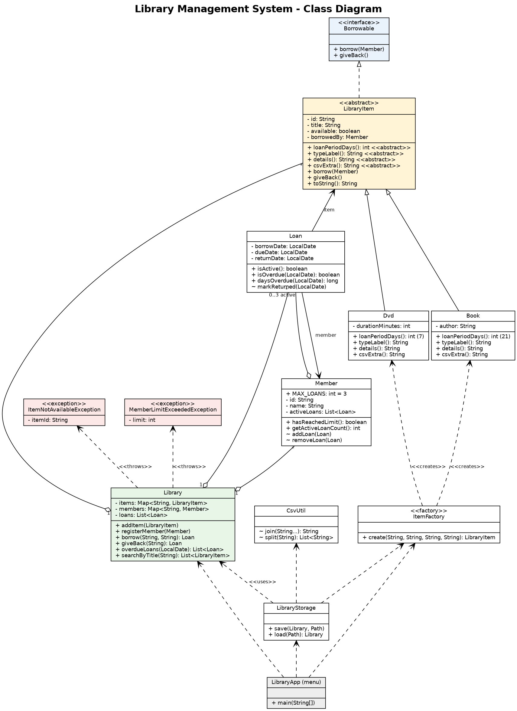

# Library Management System - Mini-Project Report

**Course:** Object-Oriented Programming in Java (Lab 11)
**Students:** [Name 1, Student ID] and [Name 2, Student ID]
**Institution:** Harare Institute of Technology

## 1. Introduction

This project is a console-based Library Management System written in Java. It lets a librarian add books and DVDs, register members, lend and take back items, find overdue items and search by title. All data is saved to CSV files when the program exits and reloaded when it starts, so nothing is lost between runs.

The aim was to combine the main ideas from Labs 1 to 10 (classes, encapsulation, inheritance, abstraction, polymorphism, interfaces, exceptions, collections, streams and file I/O) in one working application, as required by the Lab 11 brief.

## 2. Features

| Menu option | What it does |
| --- | --- |
| 1. Add item | Adds a Book (with author) or a DVD (with duration). Ids must be unique. |
| 2. Register member | Adds a member with a unique id. |
| 3. Borrow item | Lends an item to a member. Fails if the item is already on loan or the member already has 3 loans. |
| 4. Return item | Takes an item back and tells the librarian if it was late. |
| 5. List overdue items | Shows every active loan past its due date, oldest first. |
| 6. Search by title | Case-insensitive partial match, sorted alphabetically. |
| 7 / 8. List items / members | Shows all items with their status, and all members with their loan counts. |
| 0. Save and exit | Writes `items.csv`, `members.csv` and `loans.csv` to the `data` folder. |

## 3. Design



(The same diagram is in `ClassDiagram.svg`, and its source is `ClassDiagram.dot`.)

| Class | Responsibility |
| --- | --- |
| `Borrowable` (interface) | Contract for anything that can be lent: `borrow(Member)` and `giveBack()`. |
| `LibraryItem` (abstract) | State shared by all items (id, title, availability, current borrower) and the abstract `loanPeriodDays()`. |
| `Book`, `Dvd` | Concrete items. A book is lent for 21 days, a DVD for 7. |
| `Member` | A library member. Holds the member's active loans and enforces the maximum of 3. |
| `Loan` | One borrowing: member, item, borrow date, due date and return date. |
| `Library` | The core service. Holds the `Map`s of items and members and the list of loans, and applies the business rules. |
| `ItemFactory` | Factory pattern: creates a `Book` or `Dvd` from a type name, so callers never use `new Book` or `new Dvd` directly. |
| `LibraryStorage`, `CsvUtil` | Save and load the library as CSV files. `CsvUtil` handles commas and quotes inside titles. |
| `ItemNotAvailableException`, `MemberLimitExceededException` | Custom checked exceptions for the two borrowing rules. |
| `LibraryApp` | The menu. Contains no business rules, it only reads input and calls `Library`. |

## 4. How the OOP principles are applied

**Encapsulation.** Every field is `private`. Constructors validate their input (blank ids, titles, names and non-positive durations throw `IllegalArgumentException`), so an invalid object cannot exist. `Library` and `Member` return unmodifiable copies (`List.copyOf`) of their collections, so outside code cannot bypass the loan limit. `addLoan` and `markReturned` are package-private so only the library's own classes can change loan state.

**Inheritance.** `Book` and `Dvd` extend `LibraryItem` and reuse its id, title and availability logic, adding only what is specific to them (author or duration).

**Abstraction.** `LibraryItem` is abstract and declares `loanPeriodDays()`, `typeLabel()`, `details()` and `csvExtra()`, which every item type must implement. `Borrowable` separates "what can be done" from "how it is done".

**Polymorphism.** `Loan` calculates the due date with `item.loanPeriodDays()` without knowing whether the item is a book or a DVD, so a book gets 21 days and a DVD 7 days. `LibraryItem.toString()` calls the abstract `details()`, and the same code lists books and DVDs together. Adding a new item type (for example a Magazine) needs only a new subclass and one line in `ItemFactory`.

**Design principles.** Each class has one job (for example `LibraryStorage` only does file I/O and `LibraryApp` only does user interaction). `Library` works with the `LibraryItem` type, not with `Book` or `Dvd`. Composition is used where the relationship is "has-a" (a `Library` has items, members and loans).

## 5. Exceptions and error handling

- `ItemNotAvailableException` (checked) is thrown when an item is already on loan.
- `MemberLimitExceededException` (checked) is thrown when a member already has 3 loans. The limit is the constant `Member.MAX_LOANS`.
- Both are checked, so the compiler forces every caller (including the menu) to handle them.
- `Library.borrow` checks every rule before changing anything, so a failed borrow leaves no half-finished state (tested).
- Unknown ids, duplicate ids and invalid values throw `IllegalArgumentException`; the menu catches these and prints a friendly message instead of crashing.
- File problems are reported as `IOException`, with the file name and line number of a corrupt CSV line. If the saved data is corrupt, the program stops without overwriting it.

## 6. Collections and streams

- `Map<String, LibraryItem>` and `Map<String, Member>` (`LinkedHashMap`) keyed by id give fast lookup and keep insertion order for listings.
- `List<Loan>` holds the full loan history.
- Streams are used for `searchByTitle` (filter, sort by title, `toList`), `overdueLoans` (filter, sort by due date) and for finding the active loan when an item is returned.

## 7. File persistence

| File | Format |
| --- | --- |
| `items.csv` | `type,id,title,extra` (extra = author or minutes) |
| `members.csv` | `id,name` |
| `loans.csv` | `memberId,itemId,borrowDate,dueDate,returnDate` (returnDate is empty while the item is still on loan) |

Item availability is not stored separately. On load it is rebuilt from the active loans, so the files cannot disagree with each other. Titles containing commas or quotes (such as `Introduction to Algorithms, 4th Edition`) are quoted by `CsvUtil`.

## 8. Testing

`LibraryTests.java` is a self-checking test suite that needs no extra libraries. It runs **46 checks, all passing**, covering:

- borrowing, due dates for books and DVDs (polymorphism) and item/member state;
- the "already on loan" and "limit of 3" rules, including that a failed borrow changes nothing;
- returning items, double returns and re-borrowing;
- overdue detection (using fixed dates) and case-insensitive, sorted search;
- validation of bad input and the factory;
- CSV round-trips, a full save and reload of the library (including a title with a comma), empty data folders and a corrupt CSV file.

The menu was also tested by hand: borrowing until the limit, borrowing an unavailable item, adding a duplicate id, returning a late item, then exiting and restarting to confirm the data was reloaded.

## 9. How to build and run

Requires JDK 17 or newer. From inside the project folder:

```
javac *.java
java LibraryApp        (the menu program)
java LibraryTests      (the automated tests)
```

The program must be run from this folder because it reads and writes the `data` folder. The `data` folder contains sample records, including one overdue loan, so option 5 shows something straight away.

## 10. Limitations and possible improvements

- Fines for late returns are not calculated; only the number of days late is shown.
- There is no way yet to remove an item or a member, or to renew a loan.
- The menu is text-only. A GUI or web front end could reuse `Library` unchanged because it contains no input or output code.
- Data is stored in CSV for simplicity. A database would be more suitable for a large library.
